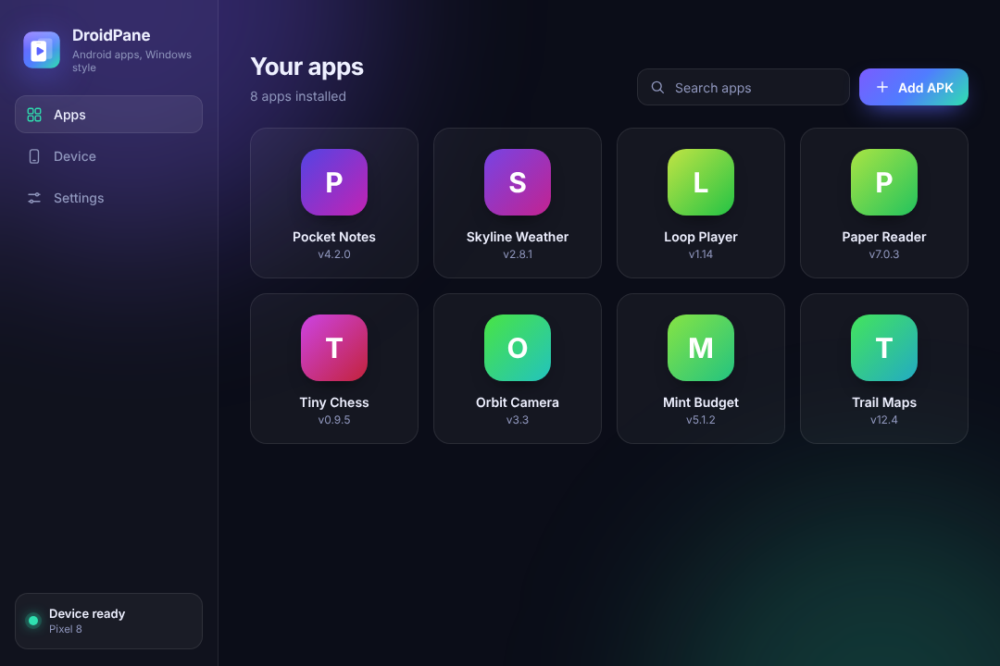

<p align="center"></p>
<h1 align="center">DroidPane</h1>
<p align="center">Run Android apps on Windows like native apps.<br>Drop an APK, get a desktop icon, open each app in its own window.</p>



> **Status: early preview (v0.1.0).** The APK reader, icon writer and command builders are covered by tests.
> The full install-and-launch path on Windows still needs testing on real machines. Bug reports are welcome.

## What it does

- **Drop or double-click an APK** to see its name, version and requested permissions, then install it.
- **One window per app.** Each app opens in its own window with its own icon, using a separate virtual display.
- **Desktop and Start menu shortcuts** with the app's real icon. A shortcut opens the app directly, without showing DroidPane.
- **Works with a real phone or the emulator.** Use a phone over USB, or let DroidPane start a headless Android Emulator for you.
- **English and Arabic** interface, with full right-to-left layout.

## How it works

DroidPane is a small Electron shell. It bundles no Android binaries. It drives three tools you install yourself:

| Tool | Used for | Required |
| --- | --- | --- |
| [scrcpy](https://github.com/Genymobile/scrcpy) 3.0+ | Showing each app in a window (`--new-display` + `--start-app`) | Yes |
| adb | Installing and removing apps (ships inside the scrcpy Windows zip) | Yes |
| Android Emulator | Running Android when no phone is connected | Optional |

APK metadata (package, label, version, permissions, icon) is read by DroidPane's own zero-dependency parsers for ZIP,
binary XML and `resources.arsc`, so no Android build tools are needed.

## Setup

1. Download [scrcpy for Windows](https://github.com/Genymobile/scrcpy/releases) and unzip it anywhere.
2. Either connect an Android phone with **USB debugging** enabled, or install Android Studio and create a virtual device in **Device Manager**.
3. Start DroidPane, open **Device**, and press **Locate…** for anything shown as *Not found*.

One window per app needs Android 10 or newer on the device. On older devices, switch **Settings → App windows** to *Mirror the device*.

## Run from source

```bash
npm install
npm start        # run the app
npm test         # run the tests (plain Node, no dependencies)
npm run dist     # build the Windows installer and portable exe into dist/
```

## Security choices

- Installing always shows the APK's requested permissions first. Nothing installs silently.
- Permissions are **not** auto-granted. Android asks inside the app window as usual.
- DroidPane does not start with Windows and does not stay in the tray.
- The interface runs sandboxed with context isolation and a strict Content Security Policy.

Only install APKs from sources you trust.

## Project layout

```
src/main/        Electron main process
  lib/zip.js       ZIP reader
  lib/axml.js      Android binary XML parser
  lib/arsc.js      resources.arsc reader
  lib/apk.js       APK metadata + icon extraction
  lib/ico.js       PNG -> ICO
  lib/adb.js       adb wrapper
  lib/runtime.js   emulator + scrcpy control
src/renderer/    Interface (plain HTML/CSS/JS)
test/            Tests with synthetic APK fixtures
```

## Roadmap

- Download scrcpy automatically on first run
- Create an emulator image from inside the app
- Per-app window size
- Split APK (`.apks` / `.xapk`) support

## عربي

**DroidPane** يشغّل تطبيقات أندرويد على ويندوز كأنها برامج عادية: اسحب ملف APK، يتثبّت، تصير له أيقونة على سطح المكتب،
وكل تطبيق يفتح بنافذة خاصة بيه. يشتغل ويه هاتف حقيقي عبر USB أو ويه محاكي أندرويد. الواجهة تدعم العربية بالكامل.

## License

MIT. scrcpy (Apache-2.0, Genymobile) and the Android SDK tools are separate projects and are not distributed with DroidPane.
